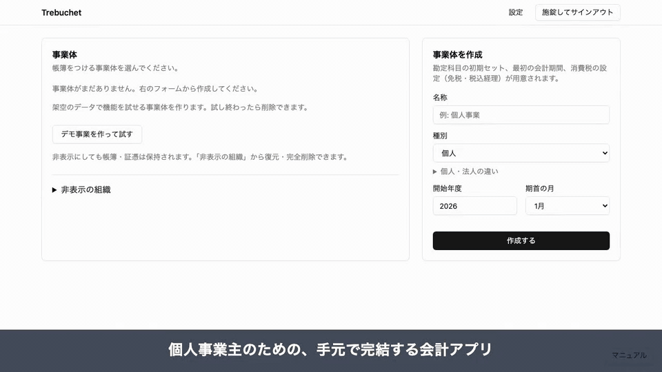

# trebuchet


**自分の Mac の中だけで動く、個人事業主向けの会計アプリ。**



30 秒の紹介動画: [日本語](docs/promo/trebuchet-ja.mp4) ／ [English](docs/promo/trebuchet-en.mp4)（デモ事業の架空のデータ。AI の応答は撮影用の固定の値）

アカウント登録も月額料金もありません。帳簿はこの Mac の暗号化されたファイルに保存します。

会計・明細の取込・請求書・証憑・青色申告決算書を一つのアプリで扱います。会計ソフト、家計アプリ、請求書サービスを行き来して同じ金額を何度も入力する手間をなくすのが目的です。

## 主な特長

- **データが手元に残る**: 帳簿はこの Mac のファイルだけ。外部のサーバーに預けず、解約で過去の帳簿が見られなくなることもない
- **請求と会計がつながる**: 請求書を発行すると売掛金・売上の仕訳になり、入金はその請求書から消し込む。源泉徴収税額の計算と年間の一覧もある
- **事業と生活が混ざった明細を扱える**: 明細は貼り付けかファイルで取り込み、行ごとに事業・私用（除外または事業主貸）を選ぶ。承認するまで仕訳にならない
- **決算書が帳簿から出る**: 青色申告決算書（一般用）を、仕訳・家事按分・減価償却・開業費の償却から作る。損益と貸借は帳票と一致する
- **帳簿の正しさを守る**: 借方と貸方が合わない仕訳は保存できない。仕訳は消さずに履歴を残して訂正し、締めた年は書き換えない
- **freee から移れる**: freee の仕訳帳と元帳を取り込み、元帳と突き合わせて確かめられる

## できること

| 機能 | 内容 |
|---|---|
| 仕訳・帳票 | 仕訳の入力（かんたん入力あり）、仕訳帳、総勘定元帳、試算表、損益計算書、貸借対照表、前年との比較 |
| 明細の取込 | 銀行・カードの明細を貼り付けかファイルで取り込む。列の対応は見出しごとに覚える。銀行の自動連携はしない |
| 仕訳の案 | ルール → この Mac の中の AI → 外部の AI（任意）の順で科目の案を出す。外部に送る前に口座番号などを伏せる。金額と日付は AI に作らせない |
| 請求 | 稼働時間（30 分単位）または月額から請求書を作り、印刷・PDF 保存。発行で仕訳、入金で消し込み。源泉徴収に対応 |
| 定期仕訳 | 家賃・通信費などを毎月の期日に自動で登録し、登録したことを知らせる |
| 証憑 | 領収書を Mac からファイルで、またはスマホで撮って保存。取引年月日・金額・取引先で探せ、仕訳と結びつける。外部の AI による値の読み取り（任意）。紙を撮ったものは紙の原本も保存する |
| 決算 | 家事按分、減価償却（定額法・少額減価償却資産の特例・一括償却資産）、開業費の償却、青色申告決算書の表示。e-Tax に入れる数字をそろえる（送信はしない） |
| 認証と暗号化 | パスキー（Touch ID）で解錠。30 分操作しないと施錠。帳簿は事業体ごとに暗号化 |
| バックアップ | 暗号化したバックアップを指定のフォルダに保存。回復キーで新しい Mac に戻せる |
| マニュアル | どの画面からも開けるアプリ内マニュアル |

部門、在庫、給与計算は扱いません。

## 対象と対象外

- **向いている人**: 一人で事業をして青色申告をする人。売上は時間単価か月額が中心。口座は事業と生活で共用。部門や在庫は不要
- **向いていない人**: 複数人で仕訳を分担したい人、法人税の申告書・別表が必要な人、領収書を撮るだけで仕訳まで自動で済ませたい人、銀行の明細を自動で取り込みたい人、Windows の利用者

## まだないもの

- インストーラー形式のアプリはない。このリポジトリを自分の Mac で起動して使う
- 法人の帳簿（法人税の申告書・別表）はない。個人事業の青色申告だけ
- 外部からのアクセスは Tailscale の tailnet の中だけ（下の「スマホから使う」）
- 申告の送信はしない

## 使ってみる

Mac（Apple silicon）、Node.js 26.5.1 以上、pnpm 11.3.0。

```sh
pnpm install
pnpm dev
```

画面は [http://localhost:5173](http://localhost:5173)。`127.0.0.1` ではパスキーが使えないので、必ず `localhost` で開く。

SQLite の暗号化に使うドライバーは、Apple silicon 向けのビルド済みのものを使う（自分でビルドする手順はない）。

初回はパスキーを登録する。PRF に対応したパスキー（iCloud キーチェーン、1Password など）が必要。登録すると回復キーが一度だけ表示されるので、「控えた」を押す前に紙に書き、この Mac とは別の場所に保管する。

サーバーはこの Mac の内側（`127.0.0.1`）だけで待ち受ける。30 分操作しないか、サインアウトすると施錠される。

テスト、型チェック、性能計測などのコマンドは [AGENTS.md](AGENTS.md) の「コマンド」にある。

## スマホから使う（Tailscale）

既定ではこの Mac の中だけで動く。スマホからは、Tailscale の tailnet の中に限って開ける。

1. `pnpm start` で web をビルドして server を起動する。画面は [http://localhost:8787](http://localhost:8787)（web と API を同じ場所から返す。待ち受けは `127.0.0.1:8787` のまま）。
2. `localhost` で開いた画面の「リモート」の「Tailscale」の欄で状態を確かめ、「開始」を押す（`tailscale serve` が始まる。止めるときは「停止」）。手で行うなら、別のターミナルで `tailscale serve --bg --https=443 http://127.0.0.1:8787` を実行する（止めるときは `tailscale serve reset`）。**Funnel は使わない**（公開インターネットに出さない）。
3. 同じ画面の「リモートの設定」で `*.ts.net` の名前を入れる（「この Mac の名前を入れる」で入る。例: `mac.tail1234.ts.net`）。「リモートを有効にする」にチェックを入れて保存する。
4. 同じ画面の「ペアリング」で「この名前で使うパスキーを追加（ペアリング）」を押す。パスキーでもう一度確認すると、ペアリングの URL と QR コードが出る。URL は 10 分間・1 回だけ有効。
5. その URL をスマホで開き（QR コードでもよい）、「このスマホのパスキーを登録」でパスキーを登録する。スマホのパスキーが PRF に対応していないと登録できない。

Mac が施錠されている間は `ts.net` の名前では使えない（先に Mac で解錠する）。パスキーの追加はペアリングの URL からだけで、`ts.net` の名前から最初の設定はできない。

## バックアップと回復キー

新しい Mac には、バックアップのファイルと回復キーだけで戻せる（パスフレーズはない）。保存先を設定していないときは、リポジトリ直下の `bak/` に置く（Git には入れない。環境変数 `TREBUCHET_DEFAULT_BACKUP_DIR` で変えられる）。`bak/` は Mac の中なので、Mac を失うとバックアップも失う。同期フォルダなどに変えておく。

回復キーは作成時と再発行時にだけ表示され、後から画面に出すことはできない。パスキーを失っても回復キーがあれば開けるが、両方を失うとバックアップも含めて読めなくなる。データを外部に預けないため、運営側で戻す手段もない。

## データの場所

既定はリポジトリ直下の `data/`（初回起動時に作られる）。変えるときは環境変数 `TREBUCHET_DATA_DIR`。

帳簿は事業体ごとに一つのファイルで、暗号化されている。鍵はディスクに平文で置かず、パスキーと回復キーで包んでいる。`data/` と `work/` は実データを含むので Git に入れない。

手でコピーするときは、サーバーを止めてから `-wal` と `-shm` のファイルも一緒にコピーする。

## 仕様

| 知りたいこと | 場所 |
|---|---|
| 仕訳、帳票、締め | [specs/001-ledger-core/](specs/001-ledger-core/) |
| freee からの移行 | [specs/002-freee-import/](specs/002-freee-import/) |
| 青色申告決算書 | [specs/003-tax-return/](specs/003-tax-return/) |
| パスキーとバックアップ | [specs/004-auth-backup/](specs/004-auth-backup/) |
| 請求と定期仕訳 | [specs/005-recurring-invoicing/](specs/005-recurring-invoicing/) |
| 明細と、仕訳の案 | [specs/006-mfme-ai-journal/](specs/006-mfme-ai-journal/) |
| どの銀行の明細でも読む | [specs/007-generic-statement-import/](specs/007-generic-statement-import/) |
| 帳簿の暗号化 | [specs/008-passkey-vault/design.md](specs/008-passkey-vault/design.md) |
| 定額法、一括償却資産、開業費 | [specs/009-depreciation-deferred/](specs/009-depreciation-deferred/) |
| 証憑（領収書・レシート） | [specs/010-receipts/](specs/010-receipts/) |
| 画面（ホーム、かんたん入力、メニュー） | [specs/011-ui-overhaul/](specs/011-ui-overhaul/) |
| アプリ内マニュアル | [docs/features/012-app-manual.md](docs/features/012-app-manual.md) |
| 源泉徴収 | [specs/013-withholding-tax/](specs/013-withholding-tax/) |
| デモ事業 | [specs/014-demo-entity/](specs/014-demo-entity/) |

開発の規約は [AGENTS.md](AGENTS.md)、機能ごとの置き場所と規則は [docs/features/](docs/features/)。要件の状態は [docs/requirements.md](docs/requirements.md)。設計の判断は [docs/adr/](docs/adr/)。不変条件の索引は [specs/INVARIANTS.md](specs/INVARIANTS.md)。

## 免責と問い合わせ

- このアプリは記帳と書類の作成を助ける道具で、税務の助言はしません。税額・控除・申告の内容は、利用者が自分で確かめてください（必要なら税理士や税務署に相談してください）。このアプリの利用によって生じた損害・不利益について、作者は責任を負いません。
- 作者は、不具合の修正・機能の追加・税制の改正への対応を行う義務を負いません。
- 帳簿はこの Mac の暗号化されたファイルだけにあります。回復キーとパスキーの両方をなくすと、作者も含めて誰も帳簿を取り出せません。バックアップと回復キーの保管は、利用者の責任で行ってください（[バックアップと回復キー](#バックアップと回復キー)）。
- 外部の AI（任意）を有効にすると、伏せた後の明細の内容や証憑の画像が、その AI の事業者へ送られます。送った情報の扱いは、その事業者の規約に従います。
- 税率・償却率・様式などの税制の値は、収録した年分のものです。改正に追いついていないことがあります。
- freee、Tailscale、e-Tax などの名称は、各社・各機関の商標または登録商標です。このアプリは、それらの事業者・機関と関係がありません。
- 不具合の報告や修正の要望は、GitHub の Issue でお知らせください。すべての要望に対応するとは限りません。

## ライセンス

[MIT License](LICENSE)。
